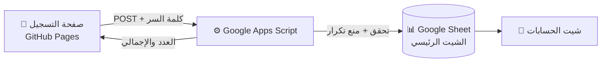

<div align="center">

# ✝️ منصة التسجيل — معهد الكتاب المقدس

### «في اتشوب» · كاتدرائية الشهيد العظيم مار جرجس بمدينة العاشر من رمضان


**صفحة تسجيل أوفلاين داخل الكنيسة، كل التسجيلات بتتجمع لحظياً في شيت واحد.**

</div>

---

## ✨ المميزات

| | |
|---|---|
| 📋 **بيانات موحدة** | نفس خانات التسجيل الأونلاين بالظبط، فالدمج بيبقى بدون أي اختلاف |
| 🔢 **تحقق ذكي** | الرقم القومي **14 رقم** · التليفون **11 رقم** · تحويل الأرقام العربي لإنجليزي تلقائياً |
| 📑 **قوائم جاهزة** | الحالة الاجتماعية · الكنيسة · المؤهل الدراسي · الإيبارشية ثابتة |
| 💰 **شرط الدفع** | مفيش تسجيل من غير تأكيد الدفع، والسيرفر بيتأكد كمان |
| 🧮 **حسابات تلقائية** | عدد المدفوعين × السعر، وتفصيل لكل كنيسة |
| 🚫 **منع التكرار** | الرقم القومي المتسجل قبل كده بيترفض |
| 🔐 **كلمة سر مخفية** | الدخول للمسجلين بس، والكلمة محفوظة في السيرفر ومش في الكود |
| 📶 **بيشتغل مع ضعف النت** | لو النت فصل التسجيل بيتحفظ على الجهاز وبيتبعت لما يرجع |

---

## 🧭 طريقة الشغل



---

## 📁 الملفات

```
├── index.html     ← صفحة التسجيل (ملف واحد فيه اللوجو)
├── Code.gs        ← كود Google Apps Script (للنسخ جوه الشيت، مش بيترفع هنا)
└── README.md
```

> ⚠️ **مهم:** ملف `Code.gs` فيه كلمة السر، فمتحطوش على GitHub. هو بيتحط جوه Apps Script بس.

---

## 🚀 التشغيل خطوة بخطوة

### 1️⃣ الشيت والسكريبت
1. اعمل Google Sheet بالهيدر المطلوب (15 عمود).
2. **Extensions ← Apps Script** والصق محتوى `Code.gs`، وغيّر `PIN` لكلمة السر.
3. شغّل الدالة `setupSheet` مرة واحدة، وهتظبط التحقق والقوائم وشيت الحسابات.
4. **Deploy ← New deployment ← Web app**
   - Execute as: **Me**
   - Who has access: **Anyone**
5. انسخ لينك الـ Web app.

### 2️⃣ الصفحة
1. افتح `index.html` وغيّر قيمة `URL_ENDPOINT` للينك اللي نسخته.
2. ارفع الملف على GitHub.

### 3️⃣ النشر
**Settings ← Pages ← Deploy from a branch ← main ← Save**

وهيظهر لينك الصفحة، افتحه من أي موبايل 📱

---

## 💵 الحسابات

شيت **الحسابات** بيتحدث لوحده:

- سعر الاشتراك (بيتغير من الخلية `B1`)
- عدد المدفوعين
- إجمالي المبلغ
- عدد المدفوعين لكل كنيسة

---

## 🛡️ الأمان

- الصفحة بتضيف بيانات بس، ومش بتعرض أي تسجيلات.
- كلمة السر بتتراجع في السيرفر، ومش موجودة في الكود المنشور.
- بعد 10 محاولات غلط الدخول بيتقفل 10 دقايق.
- متحطش بيانات المسجلين (خصوصاً الرقم القومي) في الريبو أبداً.

---

<div align="center">

### 🙏 «كل شيء فليكن بلياقة وبحسب ترتيب»

صُنع بمحبة لخدمة معهد الكتاب المقدس · العاشر من رمضان

</div>
